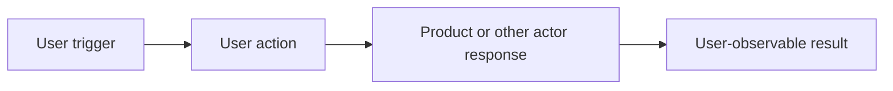

# Scope artifact template

````markdown
# Scope: <Product name>

<Short description of the currently active delivery area.>

**Build approach:** Vertical Tracer Bullets — one independently verifiable user/business outcome per slice.

## At a glance

| # | Increment | Phase | Status |
|---|-----------|-------|--------|
| A | <Existing product capability> | Existing | existing |
| 1 | <Previously released increment> | Released | done |
| 2 | <Current increment> | Current | in-progress |

## Existing / Released

### A. <Existing capability> · existing
<Short repository-grounded description.>

### 1. <Released increment> · done
**Goal:** <What it delivered.>
**Done when:** <Observable result.>

## Current Increment

### 2. <Current increment> · in-progress

**Goal:** <Outcome>

**In scope:**
- ...

**Out of scope:**
- ...

**Done when:** <Observable end-to-end result>

**End-to-end user journey:** <Describe the user's path to the increment's observable value.>



Replace sample nodes with the increment's actual behavior. Add workflow or business-rule diagrams only when they clarify behavior the prose leaves hard to follow; keep every diagram aligned with the written boundary and acceptance criteria.

### Vertical slices

#### S1 — <Slice name> · planned
**Outcome:** <One observable user/business outcome>

**Acceptance:**
- ...
- ...

**Depends on:** none | Sx

**Demo / proof:** <What a user/reviewer can demonstrate when complete>

#### S2 — <Slice name> · planned
...

## Deferred

- `CAP-XX` — <Capability / requirement not selected yet>

## Product Learnings

- <Durable learning from real user feedback that affects future scoping>
````

Keep the scope much smaller than the PRD. It carries current delivery state and vertical slice contracts, not the whole product definition.
