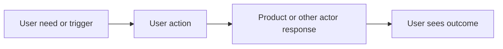

# PRD template

````markdown
# Product Requirements: <Product name>

## Product Goal
<What problem the product solves and for whom.>

## Users / Actors
- **<Actor>** — <responsibility / need>

## Core Workflows
1. <High-level end-to-end workflow>
2. <Another workflow>

<Optional Mermaid workflow diagram when the workflows are hard to follow in prose.>

## Global Business Rules
- <Rule that applies across capabilities>

<Optional Mermaid rule diagram when a rule's effects are hard to follow in prose.>

## End-to-End User Journey
<Describe the primary user's trigger, actions, handoffs, and observable outcome.>



## Capabilities

<Optional Mermaid diagram when relationships between capabilities are difficult to follow in prose.>

### CAP-01 — <Capability name>

**Goal:** <Outcome this capability enables.>

**Actors:** <Relevant actors>

**Requirements:**
- <Behavioral requirement>
- <Behavioral requirement>

**Dependencies:** none | CAP-XX, CAP-YY

**Open Questions:**
- <Question that can be resolved when this capability is scoped>

### CAP-02 — <Capability name>
...

## Cross-Cutting Requirements
- Authorization / audit / privacy / performance / accessibility / compliance constraints explicitly required by the user

## Optional / Deferred Requirements
- <Requirement explicitly described as optional/later by the user>

## Unresolved Product Questions
- <Only questions that cut across the whole product>
````

Keep this document product-level. Delivery scope and implementation state live elsewhere.
