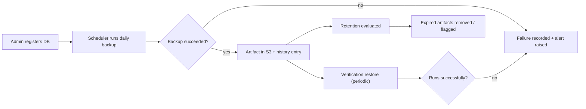
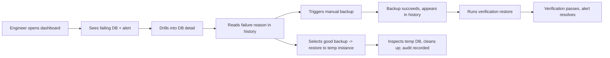
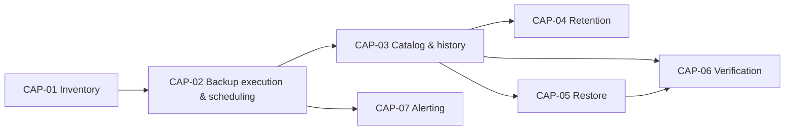

# Product Requirements: Database Backups Management

## Product Goal

Give an operations team one control surface for the daily backups of a central PostgreSQL server that is shared by multiple applications. Today backups are created by CLI/cron jobs and restorations are manual and error-prone, with no single place to see what was backed up, whether it is safe to restore, or how to restore it into a scratch database for inspection. This product turns that ad-hoc CLI workflow into an accountable system: an inventory of databases, reliable scheduled and on-demand backups written to object storage, a searchable backup history, retention policies, verifiable restores into throwaway instances, and alerting when a backup is missing or broken — all gated by roles and recorded in an audit trail.

## Users / Actors

- **Operations administrator** — registers the managed databases, configures backup schedules, retention policies, and verification behavior, and controls who can do what. Accountable owner of the backup system.
- **Operations engineer (on-call)** — monitors backup health, triggers ad-hoc backups, runs verification and inspection restores, and responds to alerts.
- **Scheduler / backup runner (system)** — executes scheduled backups, uploads artifacts to object storage, records results, evaluates retention, and raises alerts without human involvement.

## Core Workflows

1. **Register and protect a database:** an administrator adds a database that lives on the central PostgreSQL server, sets its daily backup schedule, retention policy, and verification cadence; the system begins backing it up on schedule and recording history.
2. **Observe backup health:** an engineer opens the dashboard, sees each database's last backup, current status, storage usage, and any open alerts, and drills into a database's backup history.
3. **Back up on demand:** an engineer triggers an immediate backup for a database outside the schedule and watches it complete, with the resulting artifact appearing in history.
4. **Verify restorability:** on schedule or on demand, the system restores a recent backup into a throwaway database, confirms it loads, and records the verification result against the backup and the database.
5. **Inspect via restore:** an engineer selects a backup and restores it into a new temporary instance to inspect or recover data, with the action recorded in the audit trail and the temporary instance later cleaned up.
6. **Enforce retention:** the system evaluates each database's retention policy, marks older backups as expired, and removes their artifacts (or flags them for removal per policy), never touching held backups.
7. **Respond to a failure:** when a scheduled backup is missed or fails, or a restore/verification fails, the ops team is alerted and can see the failure and its reason in history.

## Global Business Rules

- **Roles govern every action.** Viewing, backing up, changing retention, registering/editing databases, verifying, and restoring are distinct permissions enforced on the server for every request; hiding a control in the UI is never the enforcement.
- **Restores never touch the source database.** Every restore creates a new, separate database instance; production/source data is never overwritten by this system.
- **All security-sensitive actions are audited.** Backup runs (scheduled and manual), retention changes and deletions, restores, verifications, and database registration/edits record who did it, what was affected, and the outcome.
- **Credentials live in server configuration.** Database connection and object-storage credentials are supplied through server environment/configuration and are never entered or stored through the interface.
- **One team, one server, many databases.** The product serves a single operations team over a single central PostgreSQL server hosting multiple databases; there is no per-tenant isolation.
- **Lists are server-driven.** Inventory, history, and alert lists filter, sort, and paginate on the server and report accurate totals.
- **Only one backup runs per database at a time.** Overlapping runs for the same database are prevented and reported rather than silently dropped.

## End-to-End User Journey

An operations engineer starts from the dashboard, which shows every managed database with its last backup time, current status, storage used, and any open alerts. A red status or alert for one database prompts a drill-in: the database detail page shows its schedule, retention policy, backup history, and verification results, revealing that last night's scheduled backup failed. The engineer reads the failure reason, triggers a manual backup to confirm the database is reachable and healthy, and watches it succeed and appear in history. They then run a verification restore of the fresh backup, see it pass, and return to the dashboard where the alert is now resolved. Separately, when a bad change is suspected in one application's data, the engineer selects a known-good backup and restores it into a new temporary database, inspects it, and later cleans up the temporary instance — every restore step visible in the audit trail.

## Capabilities

### CAP-01 — Database Inventory

**Goal:** Maintain a trustworthy record of every database the team protects, and give a single at-a-glance health view.

**Actors:** Operations administrator, Operations engineer.

**Requirements:**
- Register a database on the central PostgreSQL server with a display name, the database's own name, and descriptive metadata such as the owning application/team and notes.
- Prevent registering the same database twice.
- List managed databases with, at minimum, last backup time, last backup status, storage used by its backups, and any open alert; search, filter, and sort on the server with accurate totals.
- Open a database detail view showing its schedule, retention policy, verification behavior, and full backup history.
- Enable/disable a database so it is temporarily excluded from scheduled backups without losing its history.

**Dependencies:** none

**Open Questions:**
- What uniquely identifies a database (database name alone, or name plus host/port)?
- When a database is removed, what happens to its backup history and remaining artifacts?

### CAP-02 — Backup Execution & Scheduling

**Goal:** Produce reliable backups on schedule and on demand, stored safely in object storage.

**Actors:** Scheduler / backup runner (system), Operations engineer, Operations administrator.

**Requirements:**
- Each managed database has a backup schedule that defaults to daily, with a configurable run time and timezone.
- The system runs the backup for a database on its schedule, uploads the artifact to object storage under a location owned by that database, and records the result (start/end time, duration, size, status, storage key, checksum).
- An engineer can trigger an immediate backup for a database outside its schedule.
- Only one backup may run per database at a time; a conflicting request is reported rather than starting a duplicate.
- Failed backups are recorded with a failure reason and status, and never leave a misleading "success" entry.
- Artifacts are organized in object storage so that a backup can later be located, verified, restored, and deleted by the system.

**Dependencies:** CAP-01

**Open Questions:**
- Backup format/compression and whether artifacts must be encrypted at rest beyond storage-level encryption.
- Maximum run duration and timeout before a backup is abandoned.
- Global concurrency limit across databases.

### CAP-03 — Backup Catalog & History

**Goal:** Make every backup discoverable and inspectable so the team can trust and act on it.

**Actors:** Operations engineer, Operations administrator.

**Requirements:**
- Provide a cross-database backup catalog, filterable by database, date range, status, and source (scheduled vs manual), with server-side sorting/pagination and accurate totals.
- Each backup entry shows its timestamp, size, duration, status (succeeded/failed/in progress), storage location, checksum, whether it was scheduled or manual, and its verification status.
- Distinguish clearly between scheduled and manual backups, and between success, failure, and in-progress states.
- From history, an engineer can open a backup's detail and act on it (verify or restore, subject to permissions).

**Dependencies:** CAP-02

**Open Questions:**
- How long history records are kept after their artifact is deleted (audit retention vs. catalog cleanup).

### CAP-04 — Retention & Lifecycle Policies

**Goal:** Bound storage growth and keep the right backups without manual housekeeping.

**Actors:** Operations administrator, Scheduler / backup runner (system).

**Requirements:**
- Support a default retention policy and per-database overrides expressed as keep rules over backup age (for example, retain a daily set and a longer-spaced set).
- The system evaluates each database's policy and identifies backups that exceed retention as expired.
- Expired backups' artifacts are removed according to policy, while held/protected backups are never removed regardless of age.
- An administrator can place a hold on a specific backup so it is exempt from retention.
- The product shows what is currently eligible for removal and what was removed, so retention actions are reviewable.

**Dependencies:** CAP-03

**Open Questions:**
- Does the system delete artifacts automatically on a schedule, or only flag them for removal and let an operator confirm?
- Is there a minimum-retention floor that cannot be configured below?

### CAP-05 — Restore Workflow (to a new instance) & Audit

**Goal:** Turn a backup into a usable database safely, and keep an accountable record of every restore.

**Actors:** Operations engineer, Operations administrator.

**Requirements:**
- An engineer can select any backup and restore it into a new, separate database instance; the source database is never modified.
- The restore lets the engineer identify/label the target instance, runs the load, tracks in-progress/succeeded/failed status, and reports the outcome and connection details of the new instance on success.
- Restore actions require the appropriate permission and are recorded in the audit trail with the backup used, the target, the actor, and the result.
- Failed restores are reported with a reason and never appear as successes.
- Temporary restored instances can be removed when no longer needed, with that cleanup visible to the team.

**Dependencies:** CAP-03

**Open Questions:**
- Is a second-person approval required before a restore, or is permission plus audit sufficient?
- Do temporary restored instances have an automatic time-to-live, or is cleanup always manual?
- Are temporary instances created on the same central server or a separate target server?

### CAP-06 — Backup Verification

**Goal:** Prove that backups are actually restorable before the team depends on them.

**Actors:** Scheduler / backup runner (system), Operations engineer.

**Requirements:**
- The system can verify a backup by test-restoring it into a throwaway instance, confirming it loads, and recording pass/fail and duration.
- Verification runs on a configurable cadence per database (and/or on demand), using a recent backup.
- Each backup and each database surfaces its latest verification result and history, so unverified or failed backups are obvious.
- Verification failures raise an alert (see CAP-07) and are distinguishable from ordinary backups that were simply never verified.

**Dependencies:** CAP-03, CAP-05

**Open Questions:**
- Which backups are verified (latest only, or a sample) and how often.
- Whether verification reuses the standard restore workflow or a lighter-weight path.

### CAP-07 — Alerting & Failure Notification

**Goal:** Ensure the ops team learns about backup problems before they matter.

**Actors:** Scheduler / backup runner (system), Operations engineer, Operations administrator.

**Requirements:**
- Detect and alert on scheduled backups that are missed or fail.
- Alert on failed restores and failed verification restores.
- Deliver alerts through the team's notification channel(s), in addition to surfacing them in the product.
- Maintain an alert history that can be acknowledged/resolved, and clear or resolve alerts once the underlying condition is healthy again.
- Avoid duplicate/noisy alerts for the same ongoing condition.

**Dependencies:** CAP-02, CAP-05, CAP-06

**Open Questions:**
- Which channels (in-app, email, webhook/chat) are required for the first release.
- How many consecutive misses/failures before an alert fires, and whether escalation is needed.

## Cross-Cutting Requirements

- **Authorization:** Distinct permissions for viewing inventory/history, running backups, changing retention and holds, registering/editing databases, running verifications, and performing restores. Enforced on the server for every request, including create/update candidates and related-record checks.
- **Audit:** Security-sensitive actions — backup execution (scheduled/manual), retention evaluation and deletions, hold changes, restore, verification, and database registration/edits — are recorded with actor, target, and outcome.
- **Credentials:** Database and object-storage credentials are provided via server environment/configuration only.
- **Notifications:** Alerting and outcome notifications use the platform's existing notification capability.
- **Data integrity:** Lists are server-paginated/filtered/sorted with accurate totals; only one backup runs per database concurrently; restores never target the source database.

## Optional / Deferred Requirements

- Support for additional database engines (MySQL, SQL Server, etc.) — PostgreSQL only for this product.
- Multi-tenancy / per-organization isolation — single team only.
- In-place restore that overwrites a source/production database.
- Point-in-time recovery and WAL/continuous archiving.
- Downloading/exporting backup artifacts directly from the interface.
- Storing per-database connection secrets in the application instead of central configuration.

## Unresolved Product Questions

- Is restore approval (a second person) required, or is permission plus audit enough?
- Should retention delete artifacts automatically or only flag them for operator confirmation?
- Which alert channels and thresholds are required for the first release?
