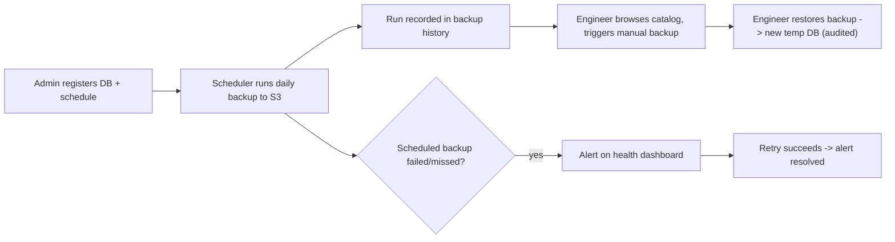

# Scope: Database Backups Management

Active delivery area: the first product increment (MVP) that turns the CLI backup workflow into a governed console covering **back up → see → recover → get alerted**, replacing the starter kit's demo domains.

**Build approach:** Vertical Tracer Bullets — one independently verifiable user/business outcome per slice.

## At a glance

| # | Increment | Phase | Status |
|---|-----------|-------|--------|
| A | Starter-kit foundation (accounts, sessions, roles/RBAC, audit, notifications) | Existing | existing |
| 1 | MVP — Back up, recover, stay accountable | Current | in-progress |

## Existing / Released

### A. Starter-kit foundation · existing
Authenticated NestJS API + React/TanStack web on Drizzle/Postgres, with accounts and sessions, roles and server-enforced permissions (`@UsePermision`/`@Conditions`), audit logging, notifications, server-paginated list patterns, and the Projects/Tasks/Tags demo domains. Preserved as-is; demo domains are replaced by slice S6.

## Current Increment

### 1. MVP — Back up, recover, stay accountable · in-progress

**Goal:** An operations team can register its central PostgreSQL databases, take scheduled and manual backups into S3, see a trustworthy backup history, restore any backup into a fresh throwaway database under audit, and be alerted when a backup fails or goes missing — all governed by roles.

**In scope:**
- `CAP-01` Database inventory: register, list, detail, enable/disable managed databases.
- `CAP-02` Backup execution & scheduling: daily (configurable time/timezone) + manual backups to S3; one run per database; results (size, duration, status, storage key, checksum) recorded; failures recorded with reason.
- `CAP-03` Backup catalog & history: cross-database browsable history with server-side filter/sort/pagination, source (scheduled/manual), status, and per-backup detail.
- `CAP-05` Restore to a new instance + audit: restore any backup into a separate temporary database; source never touched; permission-gated; fully audited; track status; show connection details; remove temporary instance when done. **Approval: permission + audit only** (no second-person approval in the MVP).
- `CAP-07` Failure alerting (basic): alert when a scheduled backup is missed or fails; surface in-product via existing notifications; acknowledge/resolve; show on health dashboard.
- Cross-cutting: distinct server-enforced permissions for view / backup-run / restore / database-admin actions; audit of all sensitive actions; database and S3 credentials from server environment only.

**Out of scope (deferred):**
- `CAP-04` Retention & lifecycle policies (keep rules, holds, auto-delete).
- `CAP-06` Scheduled verification cadence (ad-hoc restore path exists, but formal verification tracking is deferred).
- In-place restore to source; point-in-time recovery/WAL; download/export artifacts; per-database stored secrets; multi-engine; multi-tenancy; restore approval workflow.

**Done when:** A fresh install shows only the backup-management product (no demo Projects/Tasks/Tags); an operator can register a database, take a scheduled and a manual backup into S3, browse the combined history, restore a backup into a new throwaway database and see it audited, and receive an in-product alert when a scheduled backup fails — with a denied path proving an unpermitted user cannot run backups or restores.

**End-to-end user journey:** An administrator registers a database and sets its daily schedule; the scheduler backs it up to S3 and the run appears in history. An engineer browses the catalog, triggers a manual backup to confirm health, and restores a chosen backup into a temporary database to inspect it — every action recorded. When a scheduled run fails, an alert appears on the health dashboard and is resolved after a successful retry.

### Vertical slices

#### S1 — Database inventory & registration · planned
**Outcome:** An administrator can register a database on the central server and manage it; the team can see it in a list and detail view; unauthorized users are denied.

**Acceptance:**
- An administrator can register a database (display name, database name, owning app/team, notes) and it appears in the inventory list and detail view.
- Registering the same database twice is rejected with a clear error.
- The inventory list is server-paginated/filtered/sorted with accurate totals and shows last-backup (initially "never"), status, and storage used.
- A database can be enabled/disabled for scheduling without losing its record.
- A user without the inventory permissions cannot read or create databases (denied at the HTTP boundary).
- Registering/editing a database is recorded in the audit trail.

**Depends on:** none

**Demo / proof:** Register two databases, see them listed and in detail; a read-only or unprivileged user is denied; an audit entry exists for the registration.

#### S2 — Scheduled & manual backups to object storage · planned
**Outcome:** A database can be backed up on its daily schedule or on demand, producing an artifact in S3 and a recorded run result.

**Acceptance:**
- A database with a daily schedule is backed up automatically at the configured time, and a manual "back up now" trigger produces a backup immediately.
- Each completed run records start/end time, duration, size, status, S3 storage key, and checksum.
- The artifact is present in object storage at the location the system will later use for restore/delete.
- A second backup request for the same database while one is running is rejected/reported, not duplicated.
- A failed backup is stored with status `failed` and a failure reason, never as `success`.
- Database and S3 credentials are read from server configuration, not from user input.

**Depends on:** S1

**Demo / proof:** Trigger a manual backup and observe the object in S3 plus a successful history row with size/checksum; force a failure and show it recorded as failed with a reason.

#### S3 — Backup catalog & history · planned
**Outcome:** The team can browse and filter all backups across databases and inspect any backup's details.

**Acceptance:**
- A cross-database catalog lists backups and can be filtered by database, date range, status, and source (scheduled/manual), with server-side sort/pagination and accurate totals.
- Each entry shows timestamp, size, duration, status, storage location, checksum, source, and verification state (placeholder until CAP-06).
- A backup detail view shows the full metadata and offers verify/restore entry points subject to permission.
- Success, failure, and in-progress backups are visually distinct.

**Depends on:** S2

**Demo / proof:** With several backups across databases, filter to one database and to failed-only; open a backup's detail.

#### S4 — Restore to a new instance, audited · planned
**Outcome:** An engineer can restore a chosen backup into a separate new database, verify it loads, and find the action in the audit trail; the source is untouched.

**Acceptance:**
- Selecting a backup and restoring creates a new, separately named database; the source database is unchanged.
- The restore reports in-progress → succeeded/failed status and, on success, connection details for the new instance.
- A failed restore is reported with a reason and does not appear successful.
- Restore requires the restore permission; an unprivileged user is denied at the HTTP boundary.
- Each restore is audited with actor, backup used, target instance, and outcome.
- A temporary restored instance can be removed, and the removal is visible/audited.
- No second-person approval is required (permission + audit only) in this increment.

**Depends on:** S3

**Demo / proof:** Restore a backup into a new DB, connect/inspect it, confirm the source is unchanged, see the audit entry, then remove the temporary DB.

#### S5 — Failure alerting & health dashboard · planned
**Outcome:** The team is alerted in-product when a scheduled backup fails or is missed and can resolve the alert once healthy; a dashboard summarizes health across databases.

**Acceptance:**
- A failed or missed scheduled backup raises an in-product alert delivered through the existing notification capability.
- The health dashboard shows each database's last backup time/status, storage used, and open alerts.
- An alert can be acknowledged/resolved, and a subsequent successful backup clears the condition without duplicate alerts.
- Failed restores/verifications are reflected as alerts (restore failures at minimum).

**Depends on:** S2

**Demo / proof:** Simulate a failed backup, see the alert on the dashboard, run a successful retry, resolve the alert; confirm no duplicate alerts.

#### S6 — Replace demo domains & prove the main journey · planned
**Outcome:** The application presents only the backup-management product, and the primary journey plus a critical access boundary are proven end to end.

**Acceptance:**
- Projects, Tasks, and Tags routes, sidebar/global-search entries, dashboard counts, empty states, subjects, and demo seed data are replaced by product concepts.
- Account, session, role, permission, and user-administration infrastructure is preserved; product permissions/subjects and role grants replace the demo ones.
- A product seed provides representative databases, backup history, and at least one alert.
- The browser E2E covers the main journey (register → backup → browse history → restore → alert) and a denied-access boundary; `pnpm test:e2e` stays green.
- `pnpm check`, `pnpm typecheck`, `pnpm test`, and `pnpm test:integration` pass against an isolated test database.

**Depends on:** S1, S2, S3, S4, S5

**Demo / proof:** Fresh setup shows only the backup product with seeded data; the E2E main journey and denied path pass.

## Deferred

- `CAP-04` — Retention & lifecycle policies (keep rules, holds, automatic vs. flag-only removal).
- `CAP-06` — Scheduled verification cadence and verification history (beyond the ad-hoc restore path).
- In-place restore to source; point-in-time recovery/WAL archiving; artifact download/export.
- Per-database stored secrets; multi-engine support; multi-tenancy.
- Restore approval workflow.

## Product Learnings

- (none yet — capture durable feedback from real use that affects future scoping.)
